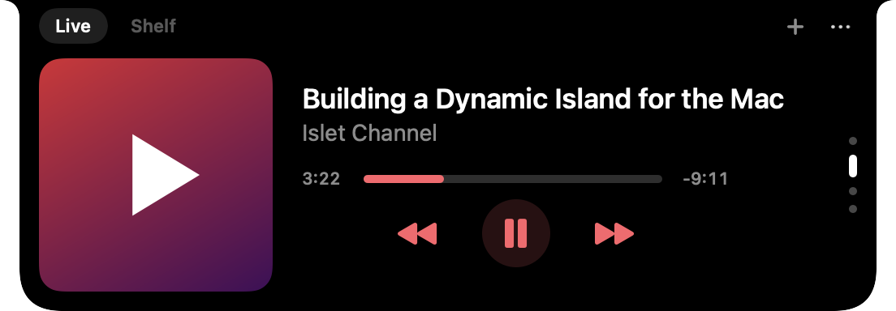
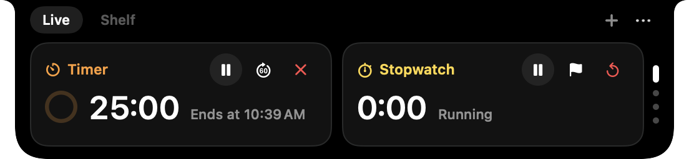
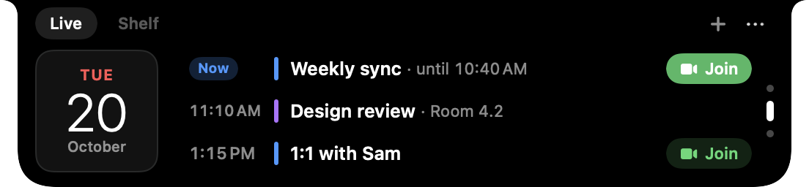
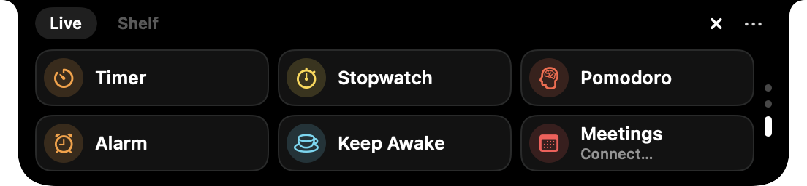

# Islet

Une Dynamic Island native pour Mac. Elle vit dans l'encoche et s'ouvre au survol. Elle fait tourner des
**Live Activities** comme sur iPhone : minuteurs que tu contrôles depuis l'île, chrono, Pomodoro, Keep
Awake, alarmes, micro/caméra actifs, **appel en cours avec sa durée**, AirPods, réunion à venir avec bouton
Rejoindre, activités envoyées par tes scripts, et reflète les minuteurs et alarmes de l'app **Horloge**. Elle
montre ce que joue **n'importe quelle app** (Musique, Spotify, YouTube dans le navigateur, Podcasts…), les
**pastilles de non-lus** de tes apps (Teams, Messages, WhatsApp…) et garde une **étagère temporaire** pour
déplacer des fichiers.

<p align="center">
  
  
  
  
</p>

Objectif n°1 : être invisible pour le système. Mesuré sur un MacBook Air M5 (macOS 26.5), build release :

| | Repos (rien ne tourne) | Un minuteur, île fermée |
| --- | --- | --- |
| Mémoire (`phys_footprint`, ce qu'affiche le Moniteur d'activité) | **14 Mo** | 15 Mo |
| CPU | **0,0 %** | 0,0 % |
| Réveils du processus | **0 par minute** | 2 par minute (changement de minute affiché), 0 écran éteint |

## Installer

Prérequis : macOS 14 (Sonoma) ou plus récent. Pensé pour les Mac à encoche ; sur les autres, Islet dessine une
pseudo-encoche au milieu de la barre des menus.

**Version prête à l'emploi (Mac Apple Silicon)** : colle ces lignes dans le Terminal. Les mêmes lignes
mettent à jour une installation existante (quitter Islet avant : menu `…` → Quit).

```bash
curl -fL -o /tmp/Islet.zip https://github.com/Tutoff/islet-notch/releases/latest/download/Islet.zip
rm -rf /Applications/Islet.app && ditto -x -k /tmp/Islet.zip /Applications
xattr -dr com.apple.quarantine /Applications/Islet.app
open /Applications/Islet.app
```

L'app n'est pas notariée par Apple (projet perso, pas de compte développeur payant) : la commande `xattr`
retire le blocage de Gatekeeper pour cette app seulement.

**Depuis les sources** (tout Mac, il faut les Command Line Tools ; Xcode n'est pas nécessaire) :

```bash
xcode-select --install
git clone https://github.com/Tutoff/islet-notch.git
cd islet-notch && scripts/bundle.sh --install && open /Applications/Islet.app
```

`scripts/bundle.sh` seul construit `dist/Islet.app` (release) avec l'outil `islet` dans `Contents/Helpers`.

**Désinstaller** : quitter Islet (menu `…` → Quit), puis supprimer `/Applications/Islet.app`.

**Permissions** : aucune n'est demandée au lancement. Chacune arrive au premier usage :
Musique/Spotify (pochette et commandes), Calendrier (au clic sur « Connect Calendar… »), dossier
Téléchargements (si tu actives la progression des téléchargements). Le miroir de l'app Horloge, les
pastilles, les appels et la lecture des autres apps n'en demandent aucune.

**Signature stable (recommandé)** : signée ad-hoc, l'app change d'identité à chaque recompilation et
macOS redemande ses autorisations. Pour l'éviter, crée une fois un certificat de signature de code
nommé `Islet Dev` : Trousseau d'accès → Assistant de certification → Créer un certificat, type
« Signature de code ». `bundle.sh` l'utilise automatiquement s'il existe.

## Live Activities

L'île fermée montre ce qui tourne, comme sur iPhone :

- **une activité** : ses infos de part et d'autre de l'encoche (anneau orange + « 12m » pour un minuteur) ;
- **deux activités** : l'île se scinde, une par côté ;
- **plus** : un point coloré par activité masquée ; micro (orange) et caméra (vert) sont des points sur
  le bord droit (pendant un appel, l'activité d'appel les remplace) ;
- **alertes** : un minuteur qui sonne déploie une carte « Thé · Terminé » avec Stop / +1 min / Recommencer ;
- **notifications éphémères** : chargeur branché, AirPods connectés, fichiers ajoutés à l'étagère (2–3 s).

Survoler l'île l'ouvre sur l'onglet **Live**, fait de pages verticales qu'on fait défiler une à une (deux
doigts sur le trackpad, un cran de molette, ↑/↓ quand l'île a le clavier, ou les points à droite) :

- **Maintenant** (seulement si quelque chose tourne) : les activités en cours, minuteurs, chrono, Pomodoro,
  Keep Awake, appel, téléchargements, minuteurs de l'app Horloge, activités personnalisées, non-lus. Une
  carte, deux cartes côte à côte, ou à partir de trois une liste (4 lignes, puis « +N ») et la carte choisie ;
- **Musique** : ce qui joue (ou est en pause) en grand, pochette presque bord à bord, titre, artiste, barre
  de progression courte et commandes aux couleurs de la pochette ; « Nothing playing » sinon ;
- **Calendrier** : une tuile avec la date du jour (comme l'icône de l'app Calendrier) et les prochains
  événements, ce qui reste d'aujourd'hui puis demain (4 au plus, badge « Now » pour celui en cours, bouton
  Join pour un appel vidéo). Avant la connexion, la tuile et « Connect Calendar… » (la permission n'est
  demandée qu'à ce clic) ;
- **Lancer** : les tuiles Minuteur, Chrono, Pomodoro, Alarme, Keep Awake et Réunions sur deux rangées, puis
  la barre de commande (les préréglages d'une tuile prennent sa place, « Custom… » la ramène).

L'île s'ouvre sur Maintenant quand quelque chose tourne, sinon sur Musique ; le bouton « + » de l'en-tête,
**⌃⌥Espace** et « Alarme… » mènent à Lancer, curseur dans la barre de commande. Rien n'est mémorisé d'une
ouverture à l'autre. Une page sortie de l'écran s'arrête (plus aucune seconde ne s'y rafraîchit). L'en-tête
n'affiche plus la batterie : elle est juste à côté, dans la barre des menus (les notices branché / batterie
faible restent).

| Activité | Ce qu'elle fait |
| --- | --- |
| Minuteurs | Plusieurs à la fois, avec étiquette ; pause, +1 min, annuler ; sonnerie jusqu'à 60 s ; survivent à un redémarrage de l'app et à la veille |
| Chrono | Tours, pause, remise à zéro |
| Pomodoro | 25/5/15 min, pauses lancées automatiquement, compteur du jour, détection d'absence |
| Keep Awake | Empêche la mise en veille (30 min, 1 h, 2 h, ∞) |
| Alarmes | Heure, jours de la semaine, répétition 9 min. Le Mac doit être allumé |
| Micro et caméra | Indique quelle app utilise le micro, avec un bouton muet |
| Appel en cours | L'app en appel et la durée (voir « Connexions aux apps ») |
| Pastilles non lues | Total des pastilles du Dock de tes apps, une tuile par app (voir « Connexions aux apps ») |
| Lecture en cours | Morceau, vidéo ou podcast de n'importe quelle app, avec lecture/pause et morceau suivant |
| AirPods et sortie audio | Connexion avec batterie gauche/droite/boîtier, changement de sortie |
| Économie d'énergie | Activation et désactivation, indicateur jaune |
| Réunion suivante | Compte à rebours 10 min avant ; bouton Rejoindre pour Teams, Zoom, Meet, Webex, FaceTime… |
| Téléchargements | Progression Safari/Chrome, puis Ouvrir / Afficher / Ajouter à l'étagère (désactivé par défaut) |
| Activités personnalisées | Envoyées par tes scripts avec l'outil `islet` (voir plus bas) |
| Minuteurs et alarmes de l'app Horloge | Miroir en lecture seule : minuteurs en cours ou en pause, alarme qui sonne ou en rappel ; prochaine alarme dans les Réglages. Seule action : « Ouvrir Horloge » (pause, arrêt et rappel se font dans Horloge). Une sonnerie affiche une carte muette (c'est Horloge qui sonne), fermée dès qu'on l'arrête dans Horloge. Reconnaissable à l'aiguille dans l'anneau, à l'icône d'Horloge et au préfixe « Clock · ». Réglage « Show Clock app timers and alarms » (`clockapp.enabled`, activé par défaut) |

## Connexions aux apps

Trois connexions sans aucune permission, qui ne coûtent rien au repos.

**Musique de toutes les apps.** Musique et Spotify passent par leurs propres notifications. Les autres apps
(YouTube ou Netflix dans Safari/Chrome, Podcasts, TV, VLC, lecteurs en ligne de commande) passent par
MediaRemote : titre, artiste, pochette, progression, lecture/pause, précédent/suivant. Pour une vidéo web,
la carte affiche le navigateur (« Chaîne · Google Chrome », icône du navigateur sur la vignette).
- macOS refuse depuis la 15.4 de donner ces infos à une app tierce. Islet reçoit donc les signaux de
  changement (lecture, pause, changement d'app) et, à chaque signal, lance `/usr/bin/perl`, qui charge une
  petite bibliothèque d'Islet (`Contents/Helpers/libIsletMediaRemote.dylib`), lit le morceau et se termine
  (10–30 ms, environ 5 Mo, rien ne reste en mémoire). Les commandes partent d'Islet directement.
- Limite : aucun signal n'existe pour un changement de morceau en pleine lecture. Un « suivant » fait dans
  l'app elle-même s'affiche à la fin prévue du morceau précédent, à la prochaine pause ou à l'ouverture de
  l'île. Depuis les boutons d'Islet, il s'affiche en moins d'une seconde.
- Réglage « Show what other apps play » (`nowplaying.mediaRemote`, activé par défaut). Si perl ou la
  bibliothèque manque, les Réglages l'indiquent et Musique/Spotify continuent de fonctionner.

**Pastilles de non-lus.** Islet lit le badge du Dock (`StatusLabel` de LaunchServices) des apps choisies tant
qu'elles tournent. L'île fermée montre l'icône de la dernière app qui a reçu quelque chose et le total ; une
notice « Teams · 3 » passe quand un compteur augmente. Dans l'onglet Live, les non-lus ont leur carte sur la
page Maintenant (seuls, ils n'en font pas la page d'ouverture) ; une tuile par app (un clic ouvre l'app).
- Suivies par défaut : Messages, WhatsApp, Teams, Slack, Discord, Telegram, Signal, Messenger. Mail et
  Outlook sont listés mais désactivés (leurs compteurs se comptent en centaines). Toute app qui affiche une
  pastille peut être ajoutée dans Réglages → Live Activities → Unread badges.
- macOS n'annonce pas les changements de pastille : Islet relit quand tu changes d'app, quand une app suivie
  démarre ou quitte, quand l'île s'ouvre, au réveil ou au déverrouillage de l'écran, et après un changement
  de réglage. Une lecture coûte environ 0,02 ms par app.
- Option « Check every minute » (désactivée par défaut) : un coup d'œil par minute, seulement tant qu'une
  app suivie tourne et que l'écran est allumé, pour voir un message arrivé pendant que tu restes dans la
  même app.

**L'app en appel.** Quand une app d'appel utilise le micro (FaceTime, Teams, Zoom, Slack, WhatsApp, Discord,
Skype, Signal, Telegram, ou un navigateur pour Meet/Teams web), l'île montre son icône et la durée
(« 12m »), avec un micro barré rouge si tu l'as coupé. La carte affiche « Teams · 12:34 », le micro utilisé,
la caméra, le partage d'écran (seulement les partages avec le son de l'ordinateur), et les boutons Muet et
Ouvrir. Les indicateurs micro et caméra ne doublent plus l'appel. Réglage « Show calls » (`devices.calls.enabled`).
- La durée part du moment où Islet a vu le micro s'ouvrir (lancé en plein appel, Islet compte depuis son
  lancement). Une coupure du micro de moins de 3 s ne termine pas l'appel.
- Tout usage du micro par un navigateur compte comme « Browser call » (le titre de la réunion demanderait
  une permission).

### Lancer et contrôler

| Moyen | Exemple |
| --- | --- |
| Barre de commande (onglet Live, ou **⌃⌥Espace** depuis n'importe où) | `25m` · `thé 4m` · `+5` · `pomo` · `chrono` · `réveil 7h30 sport` · `awake 2h` |
| Clic droit sur l'île | Nouveau minuteur, chrono, Keep Awake, et les actions de chaque activité (épingler, masquer 10 min) |
| Clavier quand l'île a le focus | ↑/↓ changer de page ; sur Maintenant ←/→ choisir une activité, Espace pause/reprise, ⌫ terminer ; sur Musique Espace lecture/pause ; Échap fermer |
| Liens `islet://` (Raccourcis, Raycast, Alfred) | `islet://timer/start?d=25m&label=Thé` · `islet://stopwatch/start` · `islet://awake?d=2h` · `islet://open?tab=shelf` |
| Ligne de commande | `islet timer 25m --label Thé` · `islet status` · `islet open clock` (ouvre l'app Horloge) |

Les liens `islet://` n'acceptent que des commandes sans risque. Les activités personnalisées passent
uniquement par l'outil en ligne de commande, pour qu'une page web ne puisse pas en afficher.

## L'outil `islet`

Installation : Réglages → Command Line → Install (lien dans `~/.local/bin/islet`), ou :

```bash
sudo ln -sf /Applications/Islet.app/Contents/Helpers/islet /usr/local/bin/islet
```

```bash
islet "thé 4m"                         # même syntaxe que la barre de commande
islet timer list
islet pomodoro skip
islet alarm 7:30 --label Sport --days weekdays
islet activity set --id build --title Build --subtitle Islet --symbol hammer --tint blue --progress 0
islet activity set --id build --progress 40%
islet activity end --id build --state done --subtitle "Compilé en 42 s"
```

Codes de sortie : 0 succès, 1 commande refusée, 2 erreur d'usage, 3 app injoignable. `--json` donne la
réponse brute.

### Recette : Claude Code dans l'encoche

Dans `~/.claude/settings.json` (Réglages → « Claude Code hooks: Copy » produit le même JSON avec un
chemin absolu) :

```json
{
  "hooks": {
    "UserPromptSubmit": [{"hooks": [{"type": "command", "command": "islet -q activity set --id claude --title 'Claude Code' --subtitle Working --symbol sparkles --tint orange --progress indeterminate --ttl 15m || true"}]}],
    "PostToolUse": [{"matcher": "*", "hooks": [{"type": "command", "command": "islet -q --no-launch activity set --id claude --subtitle Working --symbol sparkles --progress indeterminate --ttl 15m 2>/dev/null || true"}]}],
    "Notification": [
      {"matcher": "permission_prompt|elicitation_dialog", "hooks": [{"type": "command", "command": "islet -q activity set --id claude --title 'Claude Code' --subtitle 'Needs your input' --symbol exclamationmark.bubble --tint orange --progress none --alert --ttl 15m || true"}]},
      {"matcher": "idle_prompt", "hooks": [{"type": "command", "command": "islet -q activity end --id claude || true"}]}
    ],
    "Stop": [{"hooks": [{"type": "command", "command": "islet -q activity end --id claude --state done --title 'Claude Code' --subtitle Finished || true"}]}],
    "SessionEnd": [{"hooks": [{"type": "command", "command": "islet -q activity end --id claude || true"}]}]
  }
}
```

L'île affiche « Working » pendant que Claude travaille, alerte quand il attend ta réponse
(permission ou question) et montre « Finished » à la fin. Après une interruption (Échap), l'activité
disparaît d'elle-même dès que la session est inactive ou fermée.

`-q` évite d'injecter la réponse dans le contexte du prompt. `|| true` est important : dans Claude
Code, un code de sortie 2 bloque le prompt.

## Étagère temporaire

| Geste | Effet |
| --- | --- |
| Glisser un fichier depuis n'importe où | L'encoche s'élargit ; en approchant, deux zones apparaissent : **Étagère** et **AirDrop** |
| Glisser un fichier hors de l'étagère | Vers le Finder sur le même volume : **déplacement** (⌥ pour copier). L'élément quitte l'étagère |
| « Drag All » | Glisse tous les fichiers de l'étagère d'un coup |
| Menu `…` | Réglages, vider l'étagère, quitter |

Les fichiers du Finder sont gardés **par référence** : rien n'est copié. Seul le contenu sans fichier
réel (image glissée depuis Safari, pièce jointe Mail…) est copié dans `~/Library/Caches/dev.islet.app/Shelf/`,
puis supprimé quand on vide l'étagère ou qu'on quitte.

## Architecture

```
Sources/
  IsletUI/            thème partagé
  IsletProtocol/      vocabulaire de commandes (barre de commande, liens, CLI), Foundation seulement
  ActivityCore/       moteur : contrat LiveActivity, classement et mise en page de l'île fermée,
                      file d'alertes et de notifications, planificateur unique, horloge 1 Hz, anneau Core Animation
  ClockFeature/       minuteurs, chrono, Pomodoro, Keep Awake, alarmes
  ClockAppFeature/    miroir en lecture seule de l'app Horloge (base SQLite de mobiletimerd)
  DevicesFeature/     micro/caméra (CoreAudio, CoreMediaIO), app en appel, AirPods et sortie audio
  BatteryFeature/     batterie et économie d'énergie
  CalendarFeature/    réunion suivante et page Calendrier (EventKit)
  DownloadsFeature/   progression des téléchargements (NSProgress)
  CustomFeature/      serveur de contrôle (CFMessagePort) et activités personnalisées
  NowPlayingFeature/  lecture en cours : Musique et Spotify, autres apps par MediaRemote (+ lecteur perl)
  BadgesFeature/      pastilles du Dock des apps suivies
  ShelfFeature/       étagère
  IsletCLI/           l'outil islet
  Islet/              l'app : panel, machine d'états, vues, réglages
```

Chaque fonctionnalité est un module indépendant qui ne connaît que `IsletUI` et `ActivityCore`.
Chaque activité fournit quatre présentations (compacte, minimale, carte, alerte), comme ActivityKit.

## Pourquoi c'est léger

- **Rien ne tourne au repos** : survol par un seul `NSTrackingArea`, musique par notifications
  distribuées et signaux Darwin de MediaRemote (une lecture perl par changement, plus une à la fin prévue
  d'un morceau joué par une autre app que Musique/Spotify), pastilles relues sur
  événement (changement d'app, ouverture de l'île), batterie par notify(3), micro/caméra et appels par
  écouteurs CoreAudio/CoreMediaIO, calendrier par
  `EKEventStoreChanged`, app Horloge par kqueue sur le WAL de mobiletimerd (une lecture seule à chaque
  changement, relancée au plus 3 fois après une erreur passagère). Aucun `Timer` ; le seul coup d'œil
  périodique (pastilles, une fois par minute) est optionnel et désactivé par défaut.
- **Un seul planificateur** (`DispatchSourceTimer` sur l'horloge murale) pour toutes les échéances des
  activités (minuteurs, alarmes, réunions…). Seule exception : MediaRemote relit une fois à la fin prévue
  d'un morceau, tant qu'une app autre que Musique/Spotify joue un morceau de durée connue.
  Les états sont des dates, jamais des compteurs, donc un minuteur reste juste après une veille.
- **Les secondes ne s'affichent que quand elles sont visibles.** L'île fermée montre les minutes (« 12m »)
  et passe aux secondes dans la dernière minute.
- **Les anneaux tournent dans le WindowServer** (`CAShapeLayer` limité à 2–4 images/s) : un
  minuteur coûte ~0 CPU à l'app.
- Les sources (CoreAudio, EventKit, NSProgress) ne démarrent que si leur fonction est activée ; la
  fenêtre de réglages est détruite à la fermeture ; le panel a toujours la taille exacte de l'île.

## Limites connues

- Lecture des autres apps : passe par une API privée (MediaRemote) lue via `/usr/bin/perl`. Si Apple
  retire perl ou ferme cette porte, seuls Musique et Spotify restent. Le site web n'est pas connu (on voit
  « Safari », pas « YouTube »), et un changement de morceau dans le navigateur ne s'affiche qu'à
  l'ouverture de l'île ou à la fin du morceau (macOS ne le signale pas).
- Pastilles : seulement pour les apps qui tournent (la pastille de Mail disparaît quand Mail est quitté).
- Appels : le partage d'écran n'est détecté que s'il inclut le son de l'ordinateur ; CallKit (appels de
  l'iPhone) n'est pas vérifié et reste désactivé.
- Pas de recopie des notifications ni de remplacement du HUD volume/luminosité (il faudrait la
  permission Accessibilité).
- Les alarmes ne sonnent que si le Mac est allumé.
- Réunions : seuls les comptes synchronisés dans l'app Calendrier sont visibles (iCloud, Google,
  Exchange). Le nouvel Outlook seul n'y apparaît pas.
- Téléchargements : Firefox et curl ne publient pas leur progression.
- App Horloge : lecture seule ; le chrono n'est pas reflété ; l'état « sonne » ou « en rappel » des alarmes
  est déduit de la base de mobiletimerd (non vérifié en direct). Si une mise à jour de macOS change le format
  de la base, le miroir passe en « Unavailable » dans les Réglages sans rien demander.
- Le nom « Islet » est déjà pris par une app commerciale : à renommer avant toute publication.

## Debug

En build debug, des arguments de lancement forcent un état (utile pour les captures et les tests) :

```bash
swift build && .build/debug/Islet -debugPhase open -debugCommand "25m,chrono" -debugRender sortie.png
```

`-debugPhase open|peek|alert`, `-debugTab shelf|launcher`, `-debugPage now|music|calendar|launch` (page de
l'onglet Live à la première ouverture), `-debugCalendar 1|empty` (événements fictifs sur la page Calendrier,
rien n'est lu), `-debugCommand "a,b"`, `-debugURL islet://…`,
`-debugShelf a:b`, `-debugDrag 1`, `-debugTransient battery|shelf`, `-debugRender sortie.png` (rendu hors
écran puis quitte ; les vues AppKit y apparaissent en jaune), `-debugSnapshot sortie.png` (le panel réel),
`-debugClockDB <dossier ou local.sqlite>` (le miroir Horloge lit cette copie au lieu de la vraie base),
`-debugCall com.microsoft.teams2` (appel simulé commencé il y a 12:34), `-debugBadges
"com.microsoft.teams2=3,com.apple.MobileSMS=12"` (pastilles simulées, rien n'est lu),
`-debugMedia com.google.Chrome` (vidéo simulée dans cette app, aucun lecteur n'est lu ni piloté),
`-debugDownloads 5|done:4` (téléchargements simulés, en cours ou terminés ; rien n'est surveillé ni lu),
`-debugSettings sortie.png -debugTab live -debugSettingsHeight 4200` (le volet de réglages en entier).

Hors du bundle, la lecture des autres apps a besoin de la bibliothèque (builds debug uniquement) :
`ISLET_MEDIAREMOTE_LIBRARY=/chemin/libIsletMediaRemote.dylib` (la compiler avec la commande `clang` de
`scripts/bundle.sh`).

L'outil `islet` (`.build/debug/IsletCLI --no-launch`) pilote une instance debug en cours d'exécution :
c'est le moyen le plus simple de tester les activités. Pour la faire tourner à côté de l'app installée,
donne aux deux le même `ISLET_CONTROL_PORT=un.nom` (l'instance debug écoute alors sur ce port).
